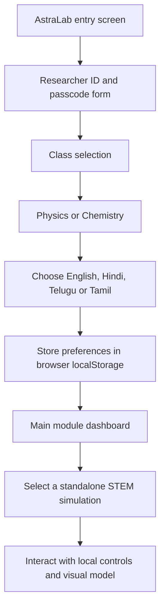

# AstraLab — Interactive STEM Lab Prototype

AstraLab is a browser-based collection of stylized STEM learning simulations. It provides a sci-fi themed entry screen, class/subject/language selection, and standalone modules for introductory physics and chemistry concepts.


## Why it matters

Interactive models can make abstract STEM concepts easier to explore. AstraLab packages small browser simulations behind a consistent learner flow, with class-level and language preferences stored locally.

## Learner flow



## Available modules

| Subject | Class | Module | File |
| --- | ---: | --- | --- |
| Physics | 8 | Friction Dynamics | `friction.html` |
| Physics | 9 | Snell's Law Optics | `optics.html` |
| Physics | 10 | Ohm's Law Matrix | `ohms_law.html` |
| Physics | 12 | Digital Logic Gates | `logic.html` |
| Chemistry | 9 | Rutherford's Foil / Atomic Structure | `atomic.html` |
| Chemistry | 10 | Acid/Base Titration | `titration.html` |

## What is implemented

- Animated entry/boot screen with a canvas particle background.
- Class, subject, and language selection.
- English, Hindi, Telugu, and Tamil UI strings on the dashboard.
- Browser-local preference persistence through `localStorage`.
- A dashboard that selects the available class/subject modules.
- Standalone interactive pages for friction, refraction, Ohm's law, logic gates, atomic structure, and titration.
- Safety acknowledgement panels within the simulation pages.

## Important: prototype boundaries

AstraLab is an educational UI and simulation prototype—not an AI engine or a validated laboratory platform.

- The entry form is a visual gate only. The inspected code accepts any non-empty form input and transitions to the next panel; it does not authenticate a researcher or validate credentials.
- Class, subject, and language preferences are saved in browser `localStorage`; there is no user database or server-side account system.
- The inspected project uses browser-side JavaScript. No AI model, remote reasoning service, chemical hazard database, or backend API is configured.
- Simulation results are illustrative learning models. They are not calibrated scientific instruments and should not be used to determine real laboratory safety.
- Tailwind CSS is loaded from its CDN; the titration page also loads Chart.js from a CDN.

## Run locally

The project uses standalone HTML pages. Open `index.html` in a modern browser, or serve the repository over HTTP:

```bash
python -m http.server 8000
```

Then open [http://localhost:8000](http://localhost:8000).

## Repository structure

```text
AstraLab/
├── index.html          # Entry and preference flow
├── dashboard.html      # Module selection dashboard
├── friction.html       # Friction simulation
├── optics.html         # Snell's law simulation
├── ohms_law.html       # Electrical circuit simulation
├── logic.html          # Digital logic gates
├── atomic.html         # Atomic structure model
└── titration.html      # Acid/base titration visualisation
```

## Evidence status

No independently validated scientific accuracy, learning-outcome, safety, performance, or benchmark results are published in this repository.

[Browse the source](https://github.com/MokuLakshithReddy/AstraLab)
